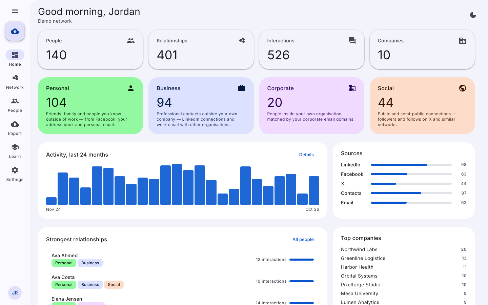
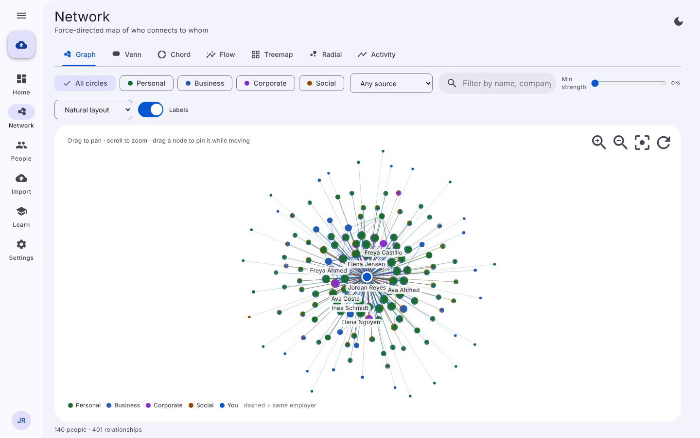

# Relationship Manager

A multi-user, installable web app (PWA) that imports your connections from **LinkedIn, Facebook, X, your address book and bidirectional email threads**, de-duplicates them into one network, and lets you explore it as **personal, business, corporate and social** circles — with a force-directed graph, Venn, chord, Sankey, treemap, radial tree and activity views. Styled after Google's Material Design 3 with dynamic colour.

<p align="center">
  
  
</p>

## Features

- **Importers** for LinkedIn `Connections.csv`, Facebook `friends.json`, X archives (`follower.js`/`following.js`) and CSVs, vCard / Google / Outlook contacts, and `.mbox`/`.eml` mail (headers only, bidirectional threads).
- **API connectors** with encrypted keys: IMAP (any provider), Google (Gmail + People), Microsoft Graph, X API v2, Facebook Graph, LinkedIn OpenID.
- **Four circles** inferred from sources and email domains, overridable per person; relationship **strength** from sources, interactions, reciprocity and recency.
- **Seven visualisations**: force graph (canvas, thousands of nodes), area-proportional Venn, chord, Sankey flow, treemap, radial dendrogram, activity timeline + heat map.
- **People directory**: search, filters, tags, notes, logged interactions, duplicate detection and merge, CSV export.
- **Multi-user**: accounts, workspaces, owner/editor/viewer roles, one-time invite links.
- **PWA**: installable, offline shell + cached data, update banner, shortcuts, share target.
- **Training**: nine narrated walkthrough videos recorded from the real app (captions, chapters, transcripts, read-aloud) and seven written guides, served inside the app under **Learn**.
- **Tests**: unit tests for the importers, and a Playwright end-to-end suite covering auth, invites, every import source, every view, people management, settings, integrations, PWA/offline and mobile layout.

## Quick start

Requires Node.js ≥ 22.13 (uses the built-in `node:sqlite`).

```bash
git clone https://github.com/RealityCramp/Relationship-Manager.git
cd Relationship-Manager
npm install
npm run seed          # optional: demo account demo@example.com / demo-password
npm run dev           # http://localhost:8787
```

Run the commands one per line (Windows PowerShell 5 does not accept `&&`). Check `node -v` prints 22.13 or newer. If PowerShell blocks `npm` with an execution-policy error, use `npm.cmd` or run `Set-ExecutionPolicy -Scope CurrentUser RemoteSigned` once.

Production:

```bash
npm run build         # dist/web (PWA) + dist/server/server.js
npm start             # serves API + PWA on $PORT (default 8787)
```

Environment variables:

| Variable | Default | Purpose |
|---|---|---|
| `PORT` | `8787` | HTTP port |
| `DATA_DIR` | `./data` | SQLite database and generated secrets |
| `DB_PATH` | `$DATA_DIR/relationship-manager.db` | Database file |
| `JWT_SECRET` | generated | Signs session cookies |
| `ENCRYPTION_KEY` | generated | AES-256-GCM key for integration secrets |
| `STATIC_DIR` | `./dist/web` | Built web app |

If `JWT_SECRET`/`ENCRYPTION_KEY` are not set they are generated once and stored in `$DATA_DIR/.secrets.json` — back it up with the database. Run behind HTTPS (set `X-Forwarded-Proto: https` from your proxy for secure cookies). A `Dockerfile` is included.

## Project layout

```
server/src        Node HTTP API (no framework): auth, workspaces, contacts, imports, connectors
  connectors/     IMAP client, Google / Microsoft / X / Facebook / LinkedIn REST connectors
  reconcile.ts    matching, merging, circle inference, strength, derived relationships
shared/src        Types, parsers (CSV, vCard, mbox, LinkedIn, Facebook, X) and graph analytics
web/src           React 19 PWA: Material 3 theme, pages, d3 visualisations, service worker
web/public        Manifest, icons, training videos and guides
e2e/              Playwright suite + generated fixtures
training/         Video recorder (Playwright + ffmpeg), scripts and index builder
docs/training     Written guides (also served in-app)
scripts/          esbuild build / dev scripts
```

## Scripts

| Command | What it does |
|---|---|
| `npm run dev` | Rebuild on change + API with auto-restart, one port |
| `npm run build` | Production build of web + server |
| `npm start` | Run the built server |
| `npm test` | Unit tests (`node --test`) |
| `npm run test:e2e` | Playwright suite (builds and starts its own server on port 8790) |
| `npm run typecheck` | `tsc --noEmit` |
| `npm run seed` | Demo account + sample data; writes `e2e/fixtures` |
| `npm run training:record` | Re-record the training videos (needs ffmpeg) |
| `npm run training:build` | Rebuild `web/public/training/index.json`; muxes `training/narration/<id>.mp3` if present |

## How matching and circles work

See [docs/training/importing-data.md](docs/training/importing-data.md) and [docs/ARCHITECTURE.md](docs/ARCHITECTURE.md). In short: people are matched by external ID → email → handle → exact name; circles come from sources (LinkedIn → Business, Facebook → Personal, X → Social) and email domains (your corporate domains → Corporate, free-mail → Personal, other → Business); strength combines source count, interaction volume, reciprocity and recency.

## Training videos

The videos in `web/public/training/` are recorded by driving the real app with Playwright (`training/videos.ts` holds the scripts and narration). They have burned-in captions, WebVTT tracks, chapters and transcripts; the in-app player can also read the transcript aloud. To add a voice track, generate audio from the `.vtt` text with any TTS tool, save it as `training/narration/<video-id>.mp3`, and run `npm run training:build`.

## License

MIT
